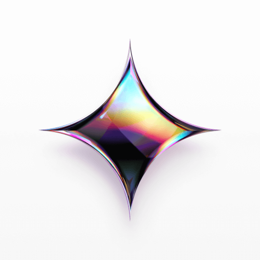

# Publisher Capability Kit

 **Notion is the CMS.** Repo: [`crafter-station/notion-publisher`](https://github.com/crafter-station/notion-publisher).

| Layer | Surfaces |
|---|---|
| **CMS** |  Notion (**live** — source of truth) |
| **Events** |  Luma (**live**),  Eventbrite via Composio (**live** · dry-run), Restream (**live** · dry-run only) |
| **Products** |  Gumroad (**live**),  GitHub (**live** · TheVeller Releases),  Skool/MySkool (**discover**) |
| **Social** |  Postly (**live**),  Composio (**live** · Reddit),  Typefully (**live** · dry-run),  Postiz (**live** · dry-run) |
| **Music / Podcast** |  ONCE.app (**stub**) |

**CMS contract (SSOT):** one Notion DB `Publisher`, views filtered by `Source Tags`, shared `Caption`/`Video`/`Image` + optional channel overrides → **[README.md](./README.md#notion-db-setup--one-database-views-by-source)**.

| Status | Meaning |
|---|---|
| **live** | Publish path wired today (or CMS in production use) |
| **discover** | API readable; no publish webhook yet |
| **stub** | Mapped only |

Self-check: `npm run capabilities:check`

## Distributors

| | ID | Layer | Status | Site |
|---|---|---|---|---|
|  | `notion` *(CMS)* | CMS | **live** | [notion.so](https://www.notion.so/) |
|  | `luma` | Events | **live** | [luma.com](https://luma.com/) |
|  | `gumroad` | Products | **live** | [gumroad.com](https://gumroad.com/) |
|  | `github` | Products | **live** | [github.com](https://github.com/) |
|  | `myskool` | Products | **discover** | [myskool.xyz](https://myskool.xyz/) |
|  | `postly` | Social | **live** | [postly.ai](https://postly.ai/) |
|  | `composio` | Social + Events | **live** · Reddit + Eventbrite | [composio.dev](https://composio.dev/) |
|  | `typefully` | Social | **live** · dry-run | [typefully.com](https://typefully.com/) |
|  | `postiz` | Social | **live** · dry-run | [postiz.com](https://postiz.com/) |
|  | `once` | Music | stub | [beta.once.app](https://beta.once.app/) |
| | `restream` | Events | **live** · dry-run only | [restream.io](https://restream.io/) |

## Discovery endpoints

| Method | Path |
|---|---|
| `GET` | `/capabilities` |
| `GET` | `/capabilities/postly` |
| `GET` | `/capabilities/skool` |
| `GET` | `/capabilities/github` |
| `GET` | `/capabilities/composio` |
| `GET` | `/capabilities/postiz` |
| `GET` | `/capabilities/typefully` |
| `GET` | `/capabilities/restream` |

### Postly (live)

| Family | Identifiers |
|---|---|
| social | `instagram`, `facebook`, `linkedin`, `x`, `threads`, `tiktok`, `youtube`, `pinterest`, `bluesky`, `googleMyBusiness` |
| messaging | `telegram`, `whatsapp` |
| blog | `wordpress`, `ghost`, `hashnode`, `devTo`, `blogger` |
| email | `email` (+ providers) |
| docs_only | `reddit` (**do not publish via Postly** — use Composio + `Channels`∋`Reddit`) |

### Composio (live · Reddit + Eventbrite · dry-run default)

Source Tag **`Composio`**. `POST /webhooks/publish-composio` (`?kind=self|link`, dry-run default; `?live=true` + `COMPOSIO_PUBLISH_LIVE=true` to execute). Discover: `GET /capabilities/composio`.

- Reddit: `REDDIT_CREATE_REDDIT_POST`
- Eventbrite: `EVENTBRITE_CREATE_EVENT` (create only; no publish-event / tickets)

Env: `COMPOSIO_API_KEY`, `COMPOSIO_USER_ID`, `COMPOSIO_CONNECTED_ACCOUNT_ID`, `COMPOSIO_REDDIT_SUBREDDIT`, `COMPOSIO_EVENTBRITE_ORGANIZATION_ID`, `COMPOSIO_EVENTBRITE_CONNECTED_ACCOUNT_ID`, `COMPOSIO_EVENTBRITE_CURRENCY`, `COMPOSIO_PUBLISH_LIVE`.

| Property | Role |
|---|---|
| `Composio Publish Status` / `Composio URL` | Source writebacks |
| `Reddit Title` / `Body` / `Subreddit` / `Link URL` / `Reddit URL` | Reddit channel |
| `Composio User ID` / `Composio Connected Account ID` | optional multi-account overrides |
| `Eventbrite Title` / `Start` / `End` / `Organization ID` / `Currency` / `Online` | Eventbrite create |

### Typefully (live · dry-run default)

Public API v2 drafts: `Authorization: Bearer $TYPEFULLY_API_KEY` → `POST /v2/social-sets/{social_set_id}/drafts`. Client: `src/services/typefully.service.ts`. Webhook: `POST /webhooks/publish-typefully`. Discover: `GET /capabilities/typefully`.

Dry-run is the default. **Never sends `publish_at`** (draft or `plan_at` only). Live needs `TYPEFULLY_PUBLISH_LIVE=true`. Platforms: X, LinkedIn, Threads, Mastodon, Bluesky.

Env: `TYPEFULLY_API_KEY`, `TYPEFULLY_SOCIAL_SET_ID`.

### Postiz (live · dry-run default — prefer self-hosted)

Public API: `Authorization: $POSTIZ_API_KEY` → `POST {POSTIZ_API_BASE}/posts`. Client: `src/services/postiz.service.ts`. Webhook: `POST /webhooks/publish-postiz`. Discover: `GET /capabilities/postiz`.

Dry-run is the default (exact payload, **no** create). Live needs `POSTIZ_PUBLISH_LIVE=true` and `?live=true`. Immediate `type=now` is never sent. Prefer self-hosted `POSTIZ_API_BASE` — no paid cloud plan assumed.

Wired write channels: **Discord, Slack, Mastodon, Skool, Twitch, Kick, Warpcast, Nostr, Lemmy, Listmonk**. Skool here is Postiz's provider (not MySkool write).

Env: `POSTIZ_API_KEY`, optional `POSTIZ_API_BASE`, `POSTIZ_INTEGRATIONS`, `POSTIZ_DISCORD_CHANNEL`, `POSTIZ_SLACK_CHANNEL`, `POSTIZ_SKOOL_GROUP`, `POSTIZ_SKOOL_LABEL`, `POSTIZ_LISTMONK_LIST`.

### ONCE.app (stub — music / podcast DSP)

Documented destinations: **Spotify**, **Apple Music**, **YouTube Music**, **Amazon Music**, **Tidal**, **Deezer**, **Pandora**, plus other DSPs via the ONCE network.

Notion: `ONCE Title`, `ONCE Audio`, `ONCE Artwork`, `ONCE Metadata`, `ONCE Targets` (multi-select of the majors above).

### Restream (live · dry-run only)

Create/schedule only: `POST https://api.restream.io/v2/user/events/new` (`streamType` studio|encoder|file). Client: `src/services/restream.service.ts`. Webhook: `POST /webhooks/publish-restream`. Discover: `GET /capabilities/restream`.

Always dry-run — never calls Restream, never go-live. StreamYard excluded. Looping is a paid feature and is rejected. Env: `RESTREAM_ACCESS_TOKEN` (optional for dry-run), `RESTREAM_CLIENT_ID`, `RESTREAM_CLIENT_SECRET`, `RESTREAM_REFRESH_TOKEN`.

### Luma (live)

Env: `LUMA_API_KEY` · webhook `POST /webhooks/publish-luma` · client `src/services/luma.service.ts`.

Creates event from `Luma Title` / `Luma Start` (+ optional End / Location / Description / **Cover** via CDN upload). Writeback: `Luma Publish Status`, `Luma Event URL`. Update / tickets = out of v1.

Import mirror: `npm run luma:import-tnc`.

Ngrok checklist: see README Luma section (button → `/webhooks/publish-luma`).

### GitHub (live)

Env: `GITHUB_TOKEN` · webhook `POST /webhooks/publish-github` · product owner **TheVeller** only.

Catalog: `GET /capabilities/github` · `npm run github:import-repos -- --owner=TheVeller`. Releases refuse non-TheVeller owners ([#5](https://github.com/crafter-station/notion-publisher/issues/5)). Ngrok checklist: README GitHub section.

### Skool (discover)

Discover via `GET /capabilities/skool`; write blocked on MySkool `POST /v1/posts` ([#4](https://github.com/crafter-station/notion-publisher/issues/4)). Key must be `sk_live_…`.

## Code map

- Registry: `src/capabilities/registry.ts`
- Postly catalog: `src/services/postly-platforms.catalog.ts`
- Skool client: `src/services/skool.service.ts`
- Luma client: `src/services/luma.service.ts`
- GitHub client: `src/services/github.service.ts`
- Restream client: `src/services/restream.service.ts`
- Logos: `docs/assets/logos/` (incl. channel favicons)
- Channel SSOT grid: [README.md](./README.md#channel-grid-all-destinations)

## Roadmap

SSOT: **[docs/PROGRESS.md](./docs/PROGRESS.md)** · [Project](https://github.com/orgs/Nucleo-Lab/projects/2) · [issues](https://github.com/crafter-station/notion-publisher/issues)

- **Completed:** milestone Shipped (#12–#14) · Luma (#9) · GitHub TheVeller (#5) · Composio Reddit live
- **Next:** Phase A leftovers (#3)
- **Later:** Skool write (#4, blocked); ONCE
