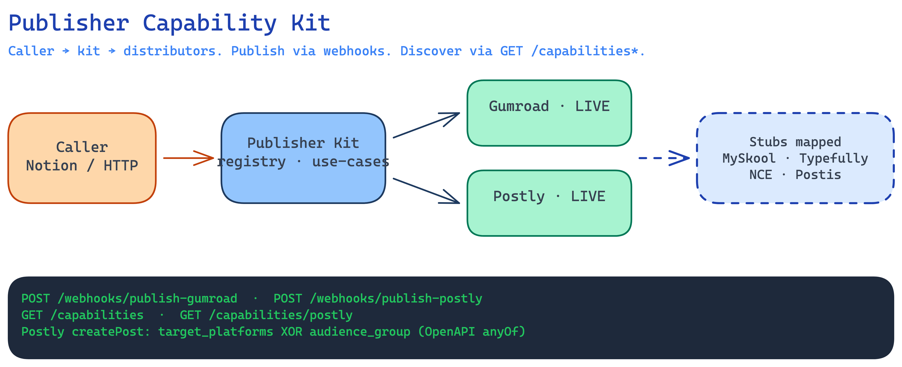

<div align="center">

```
            ╔════════════════════════════════════════════════════════════════════════╗
            ║                                                                        ║
            ║           ███╗   ██╗ ██████╗ ████████╗██╗ ██████╗ ███╗   ██╗           ║
            ║           ████╗  ██║██╔═══██╗╚══██╔══╝██║██╔═══██╗████╗  ██║           ║
            ║           ██╔██╗ ██║██║   ██║   ██║   ██║██║   ██║██╔██╗ ██║           ║
            ║           ██║╚██╗██║██║   ██║   ██║   ██║██║   ██║██║╚██╗██║           ║
            ║           ██║ ╚████║╚██████╔╝   ██║   ██║╚██████╔╝██║ ╚████║           ║
            ║           ╚═╝  ╚═══╝ ╚═════╝    ╚═╝   ╚═╝ ╚═════╝ ╚═╝  ╚═══╝           ║
            ║                                                                        ║
            ║  ██████╗ ██╗   ██╗██████╗ ██╗     ██╗███████╗██╗  ██╗███████╗██████╗   ║
            ║  ██╔══██╗██║   ██║██╔══██╗██║     ██║██╔════╝██║  ██║██╔════╝██╔══██╗  ║
            ║  ██████╔╝██║   ██║██████╔╝██║     ██║███████╗███████║█████╗  ██████╔╝  ║
            ║  ██╔═══╝ ██║   ██║██╔══██╗██║     ██║╚════██║██╔══██║██╔══╝  ██╔══██╗  ║
            ║  ██║     ╚██████╔╝██████╔╝███████╗██║███████║██║  ██║███████╗██║  ██║  ║
            ║  ╚═╝      ╚═════╝ ╚═════╝ ╚══════╝╚═╝╚══════╝╚═╝  ╚═╝╚══════╝╚═╝  ╚═╝  ║
            ║                                                                        ║
            ║                  notion-publisher · Crafter Station                    ║
            ╚════════════════════════════════════════════════════════════════════════╝
```

**Notion CMS orchestrator** — publish **events**, **products**, **social**, and **music/podcast** from Notion pages + automations.

[](./package.json)
[](./package.json)
[](https://www.notion.so/)
[](https://gumroad.com/)
[](https://postly.ai/)
[](#license)

<p>
  
  
  
  
  
  
  
  
  
  
</p>

Hosted at [`crafter-station/notion-publisher`](https://github.com/crafter-station/notion-publisher) *(public)*.  
Matrices · channels · discovery → **[CAPABILITIES.md](./CAPABILITIES.md)** · progress → **[docs/PROGRESS.md](./docs/PROGRESS.md)**

</div>

---

## Architecture



Source: [`docs/assets/publisher-capability-flow.excalidraw`](./docs/assets/publisher-capability-flow.excalidraw)

```text
Notion CMS  →  notion-publisher (this repo · no UI)
                    ├─ Events         → Luma (live) · Eventbrite via Composio (dry-run) · Restream (dry-run only)
                    ├─ Products       → Gumroad (live) · GitHub (live · TheVeller) · Skool/MySkool (discover)
                    ├─ Social         → Postly (live) · Composio (live · Reddit) · Typefully (live · dry-run) · Postiz (live · dry-run)
                    └─ Music/Podcast  → ONCE.app (stub)
```

Same **product** can ship to **Gumroad + GitHub + Skool** (Skool also adds community). Social: Postly = broad cloud; **Composio** = Reddit (+ Eventbrite on Events); Typefully = text drafts (X / LinkedIn / Threads / Mastodon / Bluesky); Postiz = widest surface, prefer **self-hosted**.

**Content OS (new):** five Notion databases (📡 Canales, 🪪 Cuentas, 🧩 Piezas, 🚀 Publicaciones, 🥇 My Templates).  
They sit under the Content OS page (`404da2435b4681eebbe6c73f68060bdd`). That page lives in the Workspaces data source `e28e7216-8dc3-4a77-a7ef-e81606bf39c8` (ancestor collection, not a database id). Schema snapshot: [`schema/notion-snapshot.json`](./schema/notion-snapshot.json) (v2).  
`POST /webhooks/publish` takes a Pieza and routes each ready Publicacion by Cuenta Connector. **Dry-run default.** Live needs `CONTENT_OS_PUBLISH_LIVE=true` + Cuenta Estado=`Activa` + Publicacion Modo=`live` (empty Modo = dry-run) + Canal Estado del conector=`live`. `Publicado el` is written only on a real publish (feeds the Piezas `Publicaciones (publicadas)` rollup). Optional Piezas design fields (`Módulo`, `Formato`, `Ratio`, `Tamaño px`, `Slides`, `Código de plantilla`, `Template origen Futuraria`, `Status de diseño`) pass through on to-cms / migrate when present. Publicaciones `Image (versión)` overrides the Pieza `Image` when set.

**Live publish today (legacy Publisher aliases):** Gumroad + Postly + Luma + GitHub (TheVeller) + Composio Reddit.  
**Discover:** Skool via MySkool read API (needs valid `sk_live_…`; write = [#4](https://github.com/crafter-station/notion-publisher/issues/4) blocked).  
**Mapped (stub):** ONCE.  
**Typefully / Postiz / Composio Eventbrite:** live clients, **dry-run default**. Typefully never sends `publish_at`.
Favicons: [`docs/assets/logos/`](./docs/assets/logos/).

**`*_PUBLISH_LIVE` does not activate live on its own.** Alias webhooks call `resolveConnectorLiveGate` without `cuentaEstado`, `publicacionModo`, or `canalEstadoDelConector`, so [`src/connectors/live-gate.ts`](./src/connectors/live-gate.ts) (the checks around lines 68–76) always returns dry-run. That is intentionally safe. Passing those Content OS values from Notion is future work — not implemented.

---

## Status matrix

| | Name | Site | Layer | Status |
|---|---|---|---|---|
|  | **Notion** | [notion.so](https://www.notion.so/) | CMS | **live** |
|  | **Luma** | [luma.com](https://luma.com/) | Events | **live** |
|  | **Gumroad** | [gumroad.com](https://gumroad.com/) | Products | **live** |
|  | **GitHub** | [github.com](https://github.com/) | Products | **live** (TheVeller Releases) |
|   | **Skool (MySkool)** | [skool.com](https://www.skool.com/) · [myskool.xyz](https://myskool.xyz/) | Products + community | **discover** |
|  | **Postly** | [postly.ai](https://postly.ai/) | Social | **live** |
|  | **Composio** | [composio.dev](https://composio.dev/) | Social + Events (transport) | live · Reddit + Eventbrite (dry-run) |
|  | **Typefully** | [typefully.com](https://typefully.com/) | Social | **live** · dry-run default |
|  | **Postiz** | [postiz.com](https://postiz.com/) | Social | **live** · dry-run default |
|  | **ONCE.app** | [beta.once.app](https://beta.once.app/) | Music / Podcast | stub |
| | **Restream** | [restream.io](https://restream.io/) | Events (live multistream) | **live** · dry-run only |

---

## Channel grid (all destinations)

One SSOT map of Notion `Channels` (+ distributor storefronts). **Delivery** = who actually ships. Reddit is **not** published via Postly (API `docs_only`); use **Composio**. Eventbrite is a **channel** under Source `Composio`, not its own Source Tag.

| | Channel | Site | Layer | Delivery | Status |
|---|---|---|---|---|---|
|  | Instagram | [instagram.com](https://instagram.com/) | Social | Postly | live |
|  | Facebook | [facebook.com](https://facebook.com/) | Social | Postly | live |
|  | LinkedIn | [linkedin.com](https://linkedin.com/) | Social | Postly / Typefully | live / stub |
|  | X / Twitter | [x.com](https://x.com/) | Social | Postly / Typefully | live / stub |
|  | Threads | [threads.net](https://threads.net/) | Social | Postly / Typefully | live / stub |
|  | TikTok | [tiktok.com](https://tiktok.com/) | Social | Postly | live |
|  | YouTube | [youtube.com](https://youtube.com/) | Social | Postly | live |
|  | Pinterest | [pinterest.com](https://pinterest.com/) | Social | Postly | live |
|  | Bluesky | [bsky.app](https://bsky.app/) | Social | Postly / Typefully | live / stub |
|  | Google Business Profile | [business.google.com](https://business.google.com/) | Social | Postly | live |
|  | Telegram | [telegram.org](https://telegram.org/) | Social | Postly | live |
|  | WhatsApp | [whatsapp.com](https://whatsapp.com/) | Social | Postly | live |
|  | WordPress | [wordpress.com](https://wordpress.com/) | Social | Postly | live |
|  | Ghost | [ghost.org](https://ghost.org/) | Social | Postly | live |
|  | Hashnode | [hashnode.com](https://hashnode.com/) | Social | Postly | live |
|  | Dev.to | [dev.to](https://dev.to/) | Social | Postly | live |
|  | Blogger | [blogger.com](https://blogger.com/) | Social | Postly | live |
|  | Email | — | Social | Postly | live |
|  | Reddit | [reddit.com](https://reddit.com/) | Social | **Composio** | live |
|  | Mastodon | [mastodon.social](https://mastodon.social/) | Social | Typefully / Postiz | stub / live (dry-run) |
|  | Medium | [medium.com](https://medium.com/) | Social | Postiz | mapped (not in v1 write set) |
|  | Discord | [discord.com](https://discord.com/) | Social | Postiz | live · dry-run default |
|  | Slack | [slack.com](https://slack.com/) | Social | Postiz | live · dry-run default |
|  | Twitch | [twitch.tv](https://twitch.tv/) | Social | Postiz | live · dry-run default |
|  | Luma Event Page | [luma.com](https://luma.com/) | Events | native (Luma) | live |
|  | Eventbrite | [eventbrite.com](https://eventbrite.com/) | Events | **Composio** | live · dry-run default |
|  | Gumroad Storefront | [gumroad.com](https://gumroad.com/) | Products | native (Gumroad) | live |
|  | GitHub Releases | [github.com](https://github.com/) | Products | native (GitHub · TheVeller) | live |
|  | Skool | [skool.com](https://skool.com/) | Products | MySkool | discover |
|  | Spotify | [spotify.com](https://spotify.com/) | Music | ONCE | stub |
|  | Apple Music | [music.apple.com](https://music.apple.com/) | Music | ONCE | stub |
|  | YouTube Music | [music.youtube.com](https://music.youtube.com/) | Music | ONCE | stub |
|  | Amazon Music / Tidal / Deezer / Pandora | ONCE network | Music | ONCE | stub |

Postiz v1 write set (dry-run default): **Discord, Slack, Mastodon, Skool, Twitch, Kick, Warpcast, Nostr, Lemmy, Listmonk**. Other Postiz-mapped Notion options (Tumblr, VK, MeWe, Whop, Dribbble, Medium, …) stay catalog-only. MySkool write stays out of scope.

---

##  Notion DB setup — one database, views by category + source

**Live CMS:** one Notion database named `Publisher` (renamed from AI POVs). `NOTION_DATABASE_ID`, `GUMROAD_AUTOPILOT_DATABASE_ID`, and `POSTLY_QUEUE_DATABASE_ID` all point at that same ID. Inventory + cutover notes: [`docs/notion-schema-inventory.md`](./docs/notion-schema-inventory.md). Old Prompt Chain Templates DB is **archive** (not deleted).

### Agent schema inspection (MCP + CLI)

Agents should **inspect** Publisher schema, not invent props. Two read paths (no secrets in git):

| Path | When | How |
|---|---|---|
| **Notion MCP** | Cursor / Claude with MCP enabled | Server `notion` → `https://mcp.notion.com/mcp` (OAuth). Confirm connected in MCP settings; workspace must include Publisher. |
| **CLI (this repo)** | Any shell / agent without MCP | `npm run notion:schema` (optional `--json`, `--filter=Gumroad`). Uses `.env` `NOTION_TOKEN` + `NOTION_DATABASE_ID`. |
| **CLI (`ntn`)** | Machine with Notion CLI | `NOTION_API_VERSION=2022-06-28 ntn api v1/databases/$NOTION_DATABASE_ID` — or newer API via `ntn api v1/data_sources/<data_source_id>`. |

Do **not** commit tokens. Integration token stays in `.env` only. MCP uses Notion OAuth (separate from `NOTION_TOKEN`).

### One database

| | |
|---|---|
| Name | `Publisher` |
| Control | `Source Tags` (multi-select) + optional `Layer` (Social / Products / Events / Music) |
| Tags | `Luma`, `Gumroad`, `GitHub`, `Skool`, `Postly`, `Composio`, `Typefully`, `Postiz`, `ONCE` |
| Channels (examples) | Postly social set · **Reddit** · **Eventbrite** · Gumroad Storefront · GitHub Releases · Luma Event Page · DSP names |

### Recommended views (create in Notion UI)

**By category / layer** (`Layer` or tag OR-filters):

| View | Filter | Purpose |
|---|---|---|
| Social — All | `Layer` = Social **or** tags Postly/Composio/Typefully/Postiz | Shared social workbench |
| Products — All | `Layer` = Products **or** tags Gumroad/GitHub/Skool | Product board |
| **Events — All** | `Layer`=`Events` **OR** `Luma` **OR** (`Composio` **AND** `Channels`∋`Eventbrite`) | Luma + Eventbrite |
| Events — Luma | `Source Tags`∋`Luma` | Luma-only subview |
| Music — ONCE | `Layer` = Music **or** `ONCE` | DSP |

**By source** (`Source Tags` contains):

| View | Filter | Purpose |
|---|---|---|
| All | — | Master board |
| Social — Postly | `Postly` | Live social publish |
| **Social — Composio / Typefully** | `Composio` **OR** `Typefully` | Reddit (Composio) + Typefully drafts |
| Social — Postiz | `Postiz` | Self-hosted scheduler |
| Products — Gumroad | `Gumroad` | Live storefront |
| Products — GitHub | `GitHub` | Releases (TheVeller) |
| Products — Skool | `Skool` | Community / product (discover → write) |

**Composio row recipe:** `Source Tags`∋`Composio` + `Channels`∋`Reddit` (Social) or `Eventbrite` (Events) + matching `Layer`.

### Shared properties (all views)

| Property | Type | Role |
|---|---|---|
| `Name` | Title | Row identity (renamed from `Rank`) |
| `Source Tags` | Multi-select | Which distributors receive the row |
| `Layer` | Select | Social / Products / Events / Music (view axis) |
| `Caption` | Rich text | Shared caption / description (social + fallback) |
| `Video` | Files & media | Shared video |
| `Image` / `Screenshot` | Files & media | Shared still |
| `GIF` | Files & media | Shared animated |
| `Audio` | Files & media | Podcast / music (ONCE) |
| `File` / `Template` | Files & media **or** rich text | Product payload (Gumroad / GitHub) |
| `Topics` | Multi-select | Content taxonomy (not a distributor) |
| `Status` | Status | Aggregate publish state |

**Alias:** parser prefers `Caption`, then `POV Text`, then per-platform captions. Existing Postly rows were dual-filled (`Caption` ← `POV Text`) on unify.

### Buttons / automations (Notion UI)

| Button | Webhook |
|---|---|
| Publish Instagram / Publish *brand* (existing) | `/webhooks/publish-postly` |
| Publish in Gumroad *(recreate on Publisher if missing — API cannot create buttons)* | existing Gumroad publish webhook |
| Publish in Social *(optional)* | `/webhooks/publish-postly` |
| Publish in Luma *(add in Notion UI)* | `/webhooks/publish-luma` |
| Publish in Skool | **not wired** — MySkool write Planned (#4) |

Product writebacks on the same DB: `Gumroad Publish Status`, `Gumroad Product ID`, `Gumroad URL`, `Gumroad Edit URL`.

### Social — shared media + optional channel overrides

One `Caption` / `Video` / `Image` / `GIF` set for Social — All / Postly / Postiz / Typefully. Attach several files on `Image` to send one carousel to every Postly network. Fill a channel override only when copy must differ; empty override → fall back to `Caption`.

| Property | Type | Role |
|---|---|---|
| `Instagram Caption` | Rich text | Instagram override |
| `Facebook Post` | Rich text | Facebook override |
| `LinkedIn Post` | Rich text | LinkedIn override |
| `TikTok Caption` | Rich text | TikTok override |
| `Twitter Post` / `X Post` | Rich text | X / Threads-related override |
| `YouTube Title` / `YouTube Caption` | Rich text | YouTube |
| `Pinterest Title` / `Pinterest Description` | Rich text | Pinterest |
| `Universal First Comment` | Rich text | First comment when supported |
| `Typefully Thread` / `Typefully Account` | Rich text / select | Typefully-only |
| `Postiz Targets` | Multi-select | Postiz destinations |
| `Postiz {Channel}` | Rich text | Postiz-only extras (Discord, Slack, …) |

Live Postly property names stay case-sensitive as listed under Postly below. Stubs reuse the same shared + override model.

### Multimedia support

| Kind | Typical property | Used by |
|---|---|---|
| Video | `Video` | Postly, Postiz, Skool, Luma cover/reel |
| Image | `Image` / `Screenshot` / covers | All layers. Several `Image` files = Postly carousel |
| GIF | `GIF` | Postly / Postiz |
| Audio | `Audio` | ONCE (music / podcast) |
| Document / JSON | `Template` / `File` | Gumroad, GitHub Releases, LinkedIn document via Postly |

Per-source product/event/music fields stay under each distributor section below.

---

##  Luma (live · dry-run default, events)

Workshops, launches, calendar. Env: `LUMA_API_KEY` · webhook `POST /webhooks/publish-luma`.

Dry-run is the default (`resolveLiveGate` + `LUMA_PUBLISH_LIVE`, off unless set). The webhook does not call Luma until both are live.

**Channels:** Luma event page (single surface).

**What we implement:** create event (`name`, `start_at`, `timezone`, optional `end_at` / `description_md` / location / **cover**) + Notion writeback. **Out of v1:** update-existing, invitations, tickets.

#### Notion property contract (case-sensitive, live)

| Property | Type | Role |
|---|---|---|
| `Luma Title` | Rich text | Event title (fallback `Luma Name` / `Name`) |
| `Luma Start` | Date | Start datetime (required) |
| `Luma End` | Date | End datetime |
| `Luma Location` | Rich text | Place → manual geo; `http(s)` → `meeting_url` |
| `Luma Description` | Rich text | Markdown → Luma `description_md` |
| `Luma Cover` | Files & media | Uploaded to Luma CDN on publish (`/v1/images/create-upload-url`) |
| `Luma Event URL` | URL | Writeback after create / import mirror |
| `Luma Publish Status` | Status | Not started / In progress / Published / Failed |

Timezone: `GUMROAD_AUTOPILOT_TIMEZONE` (default `America/Lima`). Tag row with `Source Tags` → `Luma`.

#### Import existing calendar events

```bash
npm run luma:import-tnc   # mirrors five Aug-29 The Next Craft events → Publisher (idempotent)
```

#### Ngrok + Notion button checklist (same pattern as Gumroad/Postly)

1. `unset NOTION_DATABASE_ID …` if shell has stale IDs; `set -a && source .env && set +a`
2. `npm run build && npm run dev` (note listening port)
3. `ngrok http <port>`
4. Notion → Publisher button **Publish in Luma** → automation → `POST https://<ngrok>/webhooks/publish-luma` with `Authorization: Bearer $WEBHOOK_TOKEN` (body must include `data.id` = page id)
5. Fill `Luma Title` + `Luma Start` (+ optional cover) → click button → confirm `Luma Publish Status=Published` + `Luma Event URL`

---

## Products layer

One digital product → optionally **Gumroad + GitHub + Skool**. Set `Source Tags` accordingly.

###  Gumroad (live)

Digital storefront for GPT-Chain JSON (and similar) files.

**Channels:** Gumroad product listing / storefront.

**What we implement:** create draft · multipart file/cover upload · publish / unpublish · daily autopilot.

#### Notion property contract (case-sensitive, live)

**Inputs (you fill):**

| Property | Type | Role |
|---|---|---|
| `Gumroad Title` | Rich text | Product title (fallback: `Prompt Chain Template Name`) |
| `Landing Page Copy` | Rich text | Store description (markdown → HTML in pipeline) |
| `Template` | Rich text | **Required for live publish.** Valid JSON; Notion may fragment long values — service reassembles |
| `Gumroad Cover` | Files & media | Promotional cover |
| `Gumroad Thumbnail` | Files & media | Square feed thumbnail |

**Outputs (bot fills):**

| Property | Type | Role |
|---|---|---|
| `Gumroad Publish Status` | Status | `Not started` / `Unpublished` / `Published` / `Failed` |
| `Gumroad Product ID` | Rich text | Internal id (needed to unpublish) |
| `Gumroad URL` | URL | Public short link |
| `Gumroad Edit URL` | URL | Gumroad admin edit link |

**Daily flow:** fill title / landing / cover / thumbnail + paste JSON into `Template` → Notion automation → `POST /webhooks/publish-gumroad` → status + URLs sync back.

Dry-run is the default (`resolveLiveGate` + `GUMROAD_PUBLISH_LIVE`, off unless set). The webhook does not call Gumroad until both are live.

**Draft safety:** missing/invalid `Template` → Gumroad **draft** only; Notion `Unpublished`.

**Unpublish:** `POST /webhooks/unpublish-gumroad` uses the same gate as publish (`resolveLiveGate` + `GUMROAD_PUBLISH_LIVE`, off unless set). Dry-run never calls `gumroad.unpublish()`. **Autopilot:** `GUMROAD_AUTOPILOT_ENABLED=true`.

---

###  GitHub (live · dry-run default, products)

Ship the same product as a **GitHub Release** (assets + notes) under **`TheVeller/` only**. Env: `GITHUB_TOKEN`.

Dry-run is the default (`resolveLiveGate` + `GITHUB_PUBLISH_LIVE`, off unless set). The webhook does not create a Release until both are live. If a live call reaches the use-case without `draft:false`, the Release stays a GitHub draft (`options.draft ?? true`).

**Channels:** GitHub Releases (downloadable assets). Catalog metadata import for TheVeller + orgs.

**What we implement:** list/import repo metadata · seed `README.md` + `template.json` (+ cover) from Gumroad fields · `POST /webhooks/publish-github` create Release + asset · Notion writeback. **Refuse** Releases under Nucleo-Lab / crafter-station / GPT-Chain.

**Repo seed (from same Gumroad row):** `Landing Page Copy` → README body; `Template` → `template.json`; `Gumroad Cover` → `docs/cover.*`; `Gumroad URL` → homepage + Buy link. Release body prefers real `Release Notes`, else Landing Page + Gumroad.

#### Notion property contract (case-sensitive, live)

| Property | Type | Role |
|---|---|---|
| `GitHub Repo` | Rich text | `owner/repo` (must be `TheVeller/…` for publish) |
| `GitHub Org` | Select | Catalog: `TheVeller` \| `Nucleo-Lab` \| `crafter-station` \| `GPT-Chain` |
| `Release Tag` | Rich text | e.g. `v1.2.0` — else auto `vYYYY.MM.DD-<slug>` |
| `Release Notes` | Rich text | Optional override; empty/stub → Landing Page Copy |
| `Landing Page Copy` | Rich text | README + default release body (shared with Gumroad) |
| `Template` / `File` / `GitHub Asset` | rich_text / files | Repo `template.json` + release asset |
| `Gumroad Cover` | Files | Optional `docs/cover.*` + release asset |
| `Gumroad URL` | URL | Repo homepage + Buy link |
| `GitHub Publish Status` | Status | Not started / Mapped / In progress / Failed / Published |
| `GitHub Release URL` | URL | Writeback |
| `GitHub Release ID` | Rich text | Writeback |

#### Catalog import

```bash
npm run github:import-repos -- --owner=TheVeller
npm run github:import-repos -- --owner=Nucleo-Lab --limit=20
```

Idempotent on `GitHub Repo` == `owner/repo`. Status → `Mapped`.

#### Ngrok + Notion button checklist

1. `npm run build && npm run dev`
2. `ngrok http <port>`
3. Notion button → `POST https://<ngrok>/webhooks/publish-github` with `Authorization: Bearer $WEBHOOK_TOKEN` (optional `?draft=true`)
4. Confirm `GitHub Publish Status=Published` + `GitHub Release URL`

Discover: `GET /capabilities/github?owner=TheVeller`
###   Skool / MySkool (discover)

**Channels:** Skool **groups/communities** attached to the MySkool API key (product drop + community post).

Docs: https://myskool.xyz/docs · API: `https://api.myskool.xyz/v1` · Auth: `Bearer sk_live_…`  
Env: `SKOOL_API_KEY` (must be MySkool `sk_live_…`) · optional `SKOOL_GROUP_ID` for sample posts.

**Implemented (read):** groups / posts / comments → `GET /capabilities/skool`.  
**Planned upstream:** `POST /v1/posts` (Phase 2) — write stays GitHub [#4](https://github.com/crafter-station/notion-publisher/issues/4); no invent success webhook.

#### Notion property contract (**planned** for write)

| Property | Type | Role |
|---|---|---|
| `Skool Group ID` | Rich text | Target group (`gid`) — or env `SKOOL_GROUP_ID` |
| `Skool Title` | Rich text | Post title |
| `Skool Body` | Rich text | Post body / markdown |
| `Skool Media` | Files & media | Optional (or shared `Video` / `Image`) |
| `Skool Publish Status` | Status | Output when write ships |
| `Skool Post URL` | URL | Output when write ships |

```bash
curl -s localhost:3000/capabilities/skool | jq .
```

---

## Social layer

###  Postly (live)

Broad multi-platform cloud. OpenAPI: https://docs.postly.ai/openapi.yaml

#### Channels (catalog)

| Family | Channels |
|---|---|
| Social | Instagram, Facebook, LinkedIn, X, Threads, TikTok, YouTube, Pinterest, Bluesky, Google Business Profile |
| Messaging | Telegram, WhatsApp |
| Blog | WordPress, Ghost, Hashnode, Dev.to, Blogger |
| Email | Email (+ providers) |
| Docs-only | Reddit |

Live targets: `POSTLY_TARGET_PLATFORMS` (`identifier:id`). `POSTLY_AUDIENCE_GROUP` unused by default publish.

#### Notion property contract (case-sensitive, live)

Uses the **shared Social model** above. Live parser keys today:

| Property | Type | Role |
|---|---|---|
| `POV Text` | Rich text | Shared caption alias (canonical docs name: `Caption`) |
| `Instagram Caption` | Rich text | Instagram override |
| `Facebook Post` | Rich text | Facebook override |
| `LinkedIn Post` | Rich text | LinkedIn override |
| `TikTok Caption` | Rich text | TikTok override |
| `Twitter Post` | Rich text | Threads (and related) override |
| `Pinterest Title` | Rich text | Pinterest title |
| `Pinterest Description` | Rich text | Pinterest description |
| `YouTube Title` | Rich text | YouTube title |
| `YouTube Caption` | Rich text | YouTube description |
| `Universal First Comment` | Rich text | First-comment when supported |
| `Image` | Files & media | Carousel slides (all files). Order = Notion array, then `01-` filename prefix |
| `Video` / `GIF` / `Screenshot` | Files & media | Used when `Image` has fewer than 2 files (priority: Video → GIF → Image → Screenshot) |
| `File` | Files & media | LinkedIn PDF (`content_type: document`) |

The same ordered slide set is planned for every network. Dry-run returns `accepted` / `trimmed` / `rejected` with a reason (X and Bluesky max 4, Pinterest 2–5, Instagram up to 20 JPEG only, Facebook up to 10). Nothing is dropped silently.

**Optional future overrides (catalog-ready, not required today):** `X Post`, `Bluesky Post`, `Telegram Post`, `WhatsApp Post`.

**Outputs:** `Status` (aggregate; errors → `Error`), `Postly Publish Status` (pipeline), `Postly URL` (first published URL), `Post ID` (multi-platform log). Legacy names `Instagram Status` / `Instagram URL` / option `Postly Error` were renamed in Publisher.

**Targeting:** `?target=0` / `?target=0,2`. **Polling:** backoff `[30s, 10s, 20s, 30s, 40s, 50s, 60s]`.

Dry-run is the default (`resolveLiveGate` + `POSTLY_PUBLISH_LIVE`, off unless set). The webhook and the Postly queue do not call Postly until both are live.

**Queue:** `POSTLY_QUEUE_ENABLED` is off by default. Set `POSTLY_QUEUE_ENABLED=true` only as an extra switch. The scheduler still stays idle unless the live gate and `POSTLY_PUBLISH_LIVE` are open.

---

###  Typefully (live · dry-run default)

Text-first drafts via Typefully Public API v2 (`POST /v2/social-sets/{social_set_id}/drafts`). Auth: `Authorization: Bearer $TYPEFULLY_API_KEY`.

Dry-run is the default (exact payload, **no** HTTP create). The connector **never sends `publish_at`** — drafts, or `plan_at` when `Typefully Schedule` is set (dated but inert). Live create needs `TYPEFULLY_PUBLISH_LIVE=true` and `?live=true`.

Webhook: `POST /webhooks/publish-typefully` · discover: `GET /capabilities/typefully`.

#### Channels

| Channel | Suggested override (empty → `Caption`) |
|---|---|
| X (Twitter) | `X Post` / `Twitter Post` |
| LinkedIn | `LinkedIn Post` |
| Threads | `Threads Post` / `Twitter Post` |
| Mastodon | `Typefully Mastodon` |
| Bluesky | `Typefully Bluesky` |

| Property | Type | Role |
|---|---|---|
| `Caption` | Rich text | Shared draft (same as Social) |
| `Typefully Thread` | Rich text | Appended with 4 newlines (API thread split) |
| `Typefully Account` | Rich text | Social set id (else `TYPEFULLY_SOCIAL_SET_ID`) |
| `Typefully Schedule` | Date | Optional → `plan_at` (never auto-publishes) |
| `Typefully Publish Status` | Status | Output (live only) |
| `Typefully URL` | URL | Output (live only) |

Env: `TYPEFULLY_API_KEY`, `TYPEFULLY_SOCIAL_SET_ID`. Tag `Source Tags` → `Typefully`.

---

###  Postiz (live · dry-run default)

Public API client (`POST /public/v1/posts`). Prefer **self-hosted** (`POSTIZ_API_BASE`) — no paid cloud plan assumed. Dry-run is the default: the exact create payload is built and validated, **`POST /posts` is not called**. Live create also needs `POSTIZ_PUBLISH_LIVE=true` and `?live=true`. Immediate `type=now` is never emitted.

Webhook: `POST /webhooks/publish-postiz` · discover: `GET /capabilities/postiz`.

#### Wired channels (v1)

| Family | Channels | Required settings |
|---|---|---|
| Messaging | Discord, Slack | `channel` |
| Social | Mastodon, Warpcast (Farcaster), Nostr | Warpcast channels optional |
| Communities | Lemmy, Skool (via Postiz — **not** MySkool write) | Lemmy community + title; Skool `group` / `label` / `title` |
| Live / creator | Twitch, Kick | Twitch `messageType` optional |
| Newsletter | Listmonk | `subject`, `preview`, `list` |

Env: `POSTIZ_API_KEY`, optional `POSTIZ_API_BASE`, `POSTIZ_INTEGRATIONS=discord:id,slack:id,…`, channel fallbacks (`POSTIZ_DISCORD_CHANNEL`, `POSTIZ_SLACK_CHANNEL`, `POSTIZ_SKOOL_GROUP`, `POSTIZ_SKOOL_LABEL`, `POSTIZ_LISTMONK_LIST`).

| Property | Type | Role |
|---|---|---|
| `Caption` | Rich text | Shared default (empty override → this) |
| `Postiz Targets` | Multi-select | Subset of wired channels |
| `Postiz {Channel}` | Rich text | Per-channel copy |
| `Postiz Discord Channel` / `Postiz Slack Channel` | Rich text | Provider `channel` |
| `Postiz Skool Group` / `Label` / `Title` | Rich text | Skool settings |
| `Postiz Lemmy Community` / `Community ID` / `Title` / `URL` | Rich text / URL | Lemmy settings |
| `Postiz Listmonk Subject` / `Preview` / `List` / `Template` | Rich text | Listmonk settings |
| `Postiz Schedule` | Date | If set → payload `type=schedule`, else `draft` |
| `Postiz Publish Status` | Status | Output (live only) |
| `Postiz URLs` | Rich text | Output (live only) |

Tag `Source Tags` → `Postiz`. Tests: `npm test` (mocked HTTP).

---

##  ONCE.app (stub, music / podcast)

Music DSP distribution via [ONCE.app](https://once.app/) / [beta.once.app](https://beta.once.app/). Env: `ONCE_API_KEY`.

#### DSP destinations (documented)

| DSP | Notes |
|---|---|
| Spotify | Major streaming |
| Apple Music | Major streaming |
| YouTube Music | Major streaming |
| Amazon Music | Major streaming |
| Tidal | Hi-fi / streaming |
| Deezer | Streaming |
| Pandora | Streaming (US-focused) |
| Other DSPs | Via ONCE network (do not assume a fixed extra list in Notion) |

#### Suggested Notion fields

| Property | Type | Role |
|---|---|---|
| `ONCE Title` | Rich text | Track / episode title (or `Name`) |
| `ONCE Audio` | Files & media | Master audio (or shared `Audio`) |
| `ONCE Artwork` | Files & media | Cover art (or shared `Image`) |
| `ONCE Metadata` | Rich text | JSON or credits / ISRC notes |
| `ONCE Targets` | Multi-select | Spotify, Apple Music, YouTube Music, Amazon Music, Tidal, Deezer, Pandora |
| `ONCE Publish Status` | Status | Output |
| `ONCE URL` | URL | Output |

Tag `Source Tags` → `ONCE`.

---

### Restream (live · dry-run only)

Create or schedule a Restream event (`POST /v2/user/events/new`). **Always dry-run** — the exact payload is built and validated, the create endpoint is never called, and go-live is out of scope. StreamYard is excluded.

Webhook: `POST /webhooks/publish-restream` · discover: `GET /capabilities/restream`.

`streamType`: `studio` | `encoder` | `file`. File events need `Restream File ID`. Looping (`loopsCount`) is a paid feature and is rejected.

Env: `RESTREAM_ACCESS_TOKEN` (optional for dry-run), plus OAuth extras `RESTREAM_CLIENT_ID` / `RESTREAM_CLIENT_SECRET` / `RESTREAM_REFRESH_TOKEN` if you later mint a token locally. Never commit secrets.

| Property | Type | Role |
|---|---|---|
| `Restream Title` | Rich text | Event title (or `Name`) |
| `Restream Description` | Rich text | Optional (or `Caption`) |
| `Restream Start` / `Restream Schedule` | Date | Optional `scheduledFor` |
| `Restream Stream Type` | Select / text | `studio` / `encoder` / `file` |
| `Restream File ID` | Rich text | Required when `file` |
| `Restream Publish Status` | Status | Output (unused on dry-run) |

---

## HTTP surface

Every `POST /webhooks/*` requires `Authorization: Bearer $WEBHOOK_TOKEN` (`WEBHOOK_TOKEN` ≥ 32 characters; the server refuses to start without it). A missing or bad token returns `401`.

| Method | Path | Role |
|---|---|---|
| `POST` | `/webhooks/publish` | Content OS: Pieza → ready Publicaciones (dry-run default) |
| `POST` | `/webhooks/publish-gumroad` | Gumroad dry-run (default); live needs `GUMROAD_PUBLISH_LIVE` + `resolveLiveGate` |
| `POST` | `/webhooks/unpublish-gumroad` | Gumroad unpublish dry-run (default); live needs `GUMROAD_PUBLISH_LIVE` + `resolveLiveGate` |
| `POST` | `/webhooks/publish-postly` | Postly dry-run (default); live needs `POSTLY_PUBLISH_LIVE` + `resolveLiveGate` |
| `POST` | `/webhooks/publish-luma` | Luma dry-run (default); live needs `LUMA_PUBLISH_LIVE` + `resolveLiveGate` |
| `POST` | `/webhooks/publish-github` | GitHub dry-run (default); live needs `GITHUB_PUBLISH_LIVE` + `resolveLiveGate` |
| `POST` | `/webhooks/publish-postiz` | Postiz dry-run (default) or create (`?live=true` + `POSTIZ_PUBLISH_LIVE`) |
| `POST` | `/webhooks/publish-typefully` | Typefully dry-run draft (default); never `publish_at` |
| `POST` | `/webhooks/publish-restream` | Restream create/schedule dry-run only |
| `GET` | `/capabilities` | Registry + layers + Postly catalog |
| `GET` | `/capabilities/postly` | Live socials + audience groups |
| `GET` | `/capabilities/skool` | MySkool discover (or stub message if no key) |
| `GET` | `/capabilities/github` | GitHub catalog sample (`?owner=`) |
| `GET` | `/capabilities/postiz` | Postiz wired channels + dry-run flag |
| `GET` | `/capabilities/typefully` | Typefully platforms + dry-run flag |
| `GET` | `/capabilities/restream` | Restream create/schedule dry-run only |

---

## Quick start

```bash
npm install
cp .env.example .env   # NOTION_TOKEN, GUMROAD_TOKEN, POSTLY_*
npm run build
npm run dev            # http://localhost:3000
npm run capabilities:check
```

```bash
ngrok http 3000
#   Authorization: Bearer $WEBHOOK_TOKEN on every /webhooks/* path
#   https://<ngrok>/webhooks/publish          # Content OS Pieza
#   https://<ngrok>/webhooks/publish-gumroad
#   https://<ngrok>/webhooks/unpublish-gumroad
#   https://<ngrok>/webhooks/publish-postly
#   https://<ngrok>/webhooks/publish-luma
#   https://<ngrok>/webhooks/publish-github   # optional ?draft=true
#   https://<ngrok>/webhooks/publish-postiz   # dry-run default
```

### Environment (minimal)

```env
# Required to boot
NOTION_TOKEN=
NOTION_DATABASE_ID=
GUMROAD_TOKEN=
POSTLY_API_KEY=
POSTLY_WORKSPACE_ID=
POSTLY_TARGET_PLATFORMS=instagram:id,facebook:id
WEBHOOK_TOKEN=

# Optional · live (all off by default)
# LUMA_API_KEY=
# LUMA_PUBLISH_LIVE=false
# GITHUB_TOKEN=          # TheVeller Releases + catalog
# GITHUB_PUBLISH_LIVE=false
# GUMROAD_PUBLISH_LIVE=false
# POSTLY_PUBLISH_LIVE=false
# POSTLY_QUEUE_ENABLED=false

# Optional · discover
# SKOOL_API_KEY=sk_live_xxxxxxxxxxxx
# SKOOL_GROUP_ID=

# Optional · stubs (not wired)
# COMPOSIO_API_KEY=                 # Reddit live via Composio
# COMPOSIO_USER_ID=
# COMPOSIO_CONNECTED_ACCOUNT_ID=
# COMPOSIO_REDDIT_SUBREDDIT=test
# COMPOSIO_EVENTBRITE_ORGANIZATION_ID=
# COMPOSIO_PUBLISH_LIVE=false
# TYPEFULLY_API_KEY=
# TYPEFULLY_SOCIAL_SET_ID=
# TYPEFULLY_PUBLISH_LIVE=false
# POSTIZ_API_KEY=
# POSTIZ_API_BASE=https://your-postiz.example/api/public/v1
# POSTIZ_INTEGRATIONS=discord:id,slack:id
# POSTIZ_PUBLISH_LIVE=false
# RESTREAM_ACCESS_TOKEN=
# ONCE_API_KEY=
```

Full knobs (queues, autopilot, comments): [`.env.example`](./.env.example). Matrices: [CAPABILITIES.md](./CAPABILITIES.md).

### Scripts

```bash
npm run build && npm run dev
npm run capabilities:check
npm test                       # mocked HTTP; includes Postiz dry-run
npm run schema:verify          # code ⊆ schema + Content OS dump snapshot
npm run schema:snapshot        # refresh schema/notion-snapshot.json (needs NOTION_TOKEN)
# Optional Content OS fields (not required to publish): Canales Estado del canal / Score ⭐,
# Publicaciones Resultado, Piezas 🎞️ Formato de video (plus Formato options video/reel).
npm run migrate-content-os -- --snapshot=./exports/publisher-snapshot.json
npm run notion:schema          # Publisher property dump (read-only)
npm run publisher:report
```

`migrate-content-os` is **dry-run by default** and needs **no env** (no `NOTION_TOKEN`, `GUMROAD_TOKEN`, or `POSTLY_*`). With `--dry-run` and no token — or with `--offline` — it uses the static Canales/Cuentas catalog, never reads or writes Notion, and prints a JSON report (per-layer counts, `source_rows` vs `processed_rows`, expected Publicaciones, `would_create`, `skipped_existing`, `excluded`, unmatched channels, `unknown_columns`, `ignored_columns`, and warnings). A real write needs `--live` and `NOTION_TOKEN` only.

```bash
npm run migrate-content-os -- --snapshot=./exports/publisher-snapshot.json
npm run migrate-content-os -- --snapshot=./exports/publisher-snapshot.json --offline
npm run migrate-content-os -- --snapshot=./exports/publisher-snapshot.json --live
npm run migrate-content-os -- --snapshot=./exports/publisher-snapshot.json --offline --exclude-ids=./archived-ids.txt
npm run migrate-content-os -- --snapshot=./exports/publisher-snapshot.json --offline --exclude-urls=https://www.notion.so/Workspace-aaaaaaaaaaaaaaaaaaaaaaaaaaaaaaaa
```

| Flag | Role |
|---|---|
| `--exclude-ids=<list\|file>` | Skip rows whose `page_id` / Notion URL matches a comma list or a file (one id or URL per line; `#` comments ok) |
| `--exclude-urls=<list\|file>` | Same shape as `--exclude-ids`, counted under `excluded.by_url` |

Rows whose `Status` / `archived` / `in_trash` is archived are skipped automatically. The report `excluded` object is `{ archived, by_id, by_url, total }`.

Accepted snapshot shapes: Notion API `{ id, properties }` pages, **or a flat table** (array / `{ pages|rows|results }`). Flat keys are case-insensitive and optional:

| Key | Role |
|---|---|
| `page_id` (`id`, `notion_page_id`) | Source id → Pieza key `publisher:<page_id>` written to Piezas `Clave de idempotencia` |
| `Name` (`title`) | Title. Numeric-only names warn; they do not fail the run |
| `Layer` | `Products` → Gumroad only · `Events` → Luma · `Social` uses `Channels` |
| `Channels` | JSON-array string (`["WhatsApp","Facebook"]`), real array, or comma/semicolon list. Matched to a Canal by name (accents/case-insensitive). Unknown names are reported without quotes/brackets, never defaulted to Postly |
| `Caption` | Caption base when present |
| `Source Tags` / `sources` | Legacy API-shaped rows |
| `Status`, `url` / `page_url`, `archived`, `in_trash` | Archived rows are excluded. `page_url` maps to `url`. `Postly Error` maps to Publicaciones `Error`. `Eventbrite Event ID` is listed under `ignored_columns` (no matching schema property). Other extras stay in `unknown_columns` |

Matching is by **Canal identity** (name / family), never by Conector alone — a Products row does not fan out to GitHub, Luma, or Restream. Empty Cuentas (or a row with no resolvable Cuenta) sets `status: "error"`; `--live` then exits non-zero. `static-*` catalog ids are valid only in `--offline`. Pieza skip/idempotency uses Piezas `Clave de idempotencia` (`publisher:<page_id>`), not a Publicación key prefix.

---

## Roadmap

Full ledger: **[docs/PROGRESS.md](./docs/PROGRESS.md)** · [repo](https://github.com/crafter-station/notion-publisher) · [issues](https://github.com/crafter-station/notion-publisher/issues)

- **Completed:** [#12](https://github.com/crafter-station/notion-publisher/issues/12) Gumroad · [#13](https://github.com/crafter-station/notion-publisher/issues/13) Postly · [#14](https://github.com/crafter-station/notion-publisher/issues/14) Skool discover · [#1](https://github.com/crafter-station/notion-publisher/issues/1) Publisher unify · [#2](https://github.com/crafter-station/notion-publisher/issues/2) Caption · [#5](https://github.com/crafter-station/notion-publisher/issues/5) GitHub · [#9](https://github.com/crafter-station/notion-publisher/issues/9) Luma create · [#3](https://github.com/crafter-station/notion-publisher/issues/3) Notion MCP/CLI · [#16](https://github.com/crafter-station/notion-publisher/issues/16) docs reconcile  
- **Next:** [#17](https://github.com/crafter-station/notion-publisher/issues/17)–[#19](https://github.com/crafter-station/notion-publisher/issues/19) planning (handoff / newsletter / metrics)  
- **Blocked / later:** [#4](https://github.com/crafter-station/notion-publisher/issues/4) Skool write · Phases C–D stubs  

---

## Contributing

Internal Nucleo Lab / Nebulabs tooling. Prefer tiny diffs; update [`CAPABILITIES.md`](./CAPABILITIES.md) when adding a distributor. Do not invent publish webhooks for stub/discover connectors. Agent rules: [`AGENTS.md`](./AGENTS.md).

## License

All rights reserved unless a `LICENSE` file is added later.

---

Made with love by **Crafter Station** x **Núcleo Lab**
